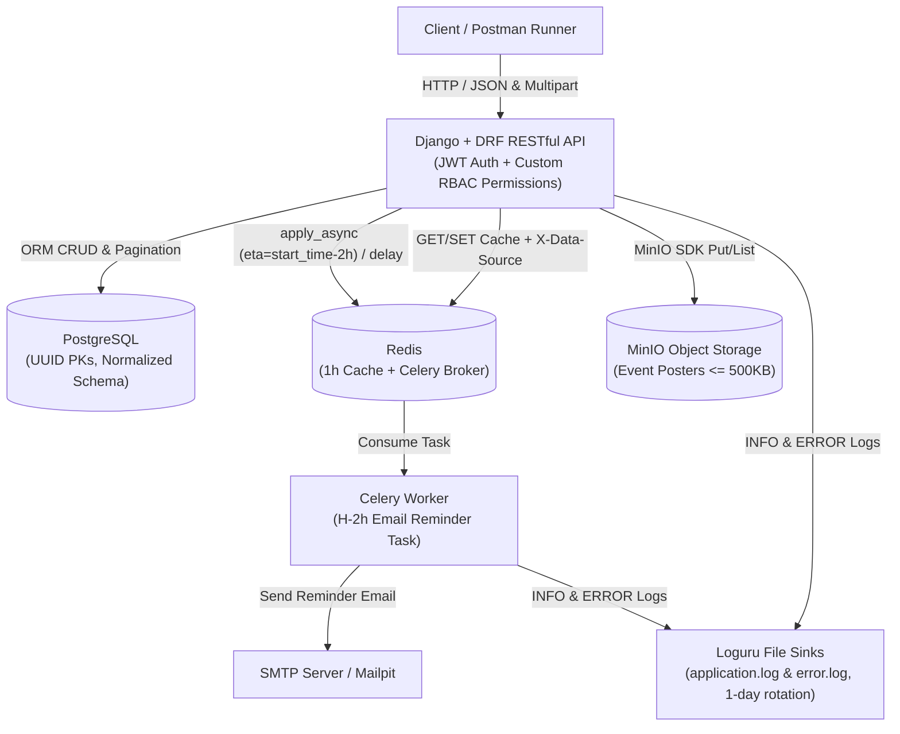
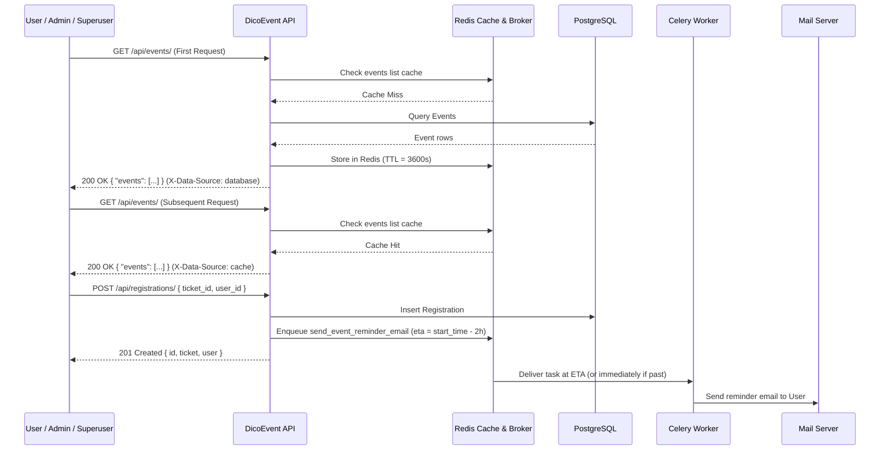

# DicoEvent Backend Specification (V1 + V2 Advanced Stack)

**Status:** resolved

## Problem Statement

Event organizers and platform administrators at DicoTech need a secure, high-performance RESTful API to manage the end-to-end lifecycle of scheduled Events—from user registration and role-based access control to ticket sales, attendee registrations, payment tracking, promotional poster management, and automated pre-event email reminders. Without a centralized backend that enforces strict role permissions (`Superuser`, `Admin`, `Organizer`, `User`), caches frequently accessed Event data, offloads reminder notifications to background workers, validates and stores promotional media in object storage, and records structured operational logs, the platform cannot reliably scale or pass the automated DicoEvent V1 and V2 verification suites.

## Solution

Build the unified **DicoEvent RESTful API** using Python and Django REST Framework backed by PostgreSQL, Redis, MinIO, Celery, and Loguru. The system provides:
- **Normalized Relational Storage in PostgreSQL** with UUID primary keys across all custom domain entities, unique email constraints, cascading deletes from Ticket to Registration and Payment, and environment-variable-driven configuration alongside an Entity Relationship Diagram (`ERD-DicoEvent-versi-1`).
- **JWT Authentication & Role-Based Access Control (RBAC)** with a custom User model, 3-hour JWT access tokens, pre-seeded Superuser credentials, Group and role-assignment endpoints, and resource-ownership enforcement so Organizers can only update or delete their own Events.
- **Event Poster Object Storage via MinIO SDK** enforcing a maximum file size of 500 KB and valid `image/*` MIME types before uploading to MinIO and persisting metadata in PostgreSQL.
- **Redis Caching with Cache Invalidation** for both Event list and Event detail endpoints with a 1-hour TTL, explicit `X-Data-Source: cache` and `X-Data-Source: database` response headers, and automatic invalidation whenever Events are created, updated, or deleted.
- **Asynchronous Event Reminders with Celery & SMTP** triggered upon Registration creation, scheduling reminder emails for 2 hours prior to the Event's `start_time` (with immediate asynchronous fallback when test Event timestamps are in the past).
- **Structured Daily-Rotated Logging with Loguru** recording `INFO` events to `application.log` and `ERROR` events to `error.log` with timestamp, level, source location, and message formatting.

## User Stories

1. As a **User**, I want to register a new account with a unique `username`, `email`, and `password`, so that I can access the DicoEvent platform and receive a unique UUID identifier.
2. As a **User**, I want to log in with my `username` and `password`, so that I receive a JWT `access` token (valid for 3 hours) and a `refresh` token.
3. As a **User**, I want to exchange a valid `refresh` token for a new `access` token, so that I can maintain my authenticated session without logging in again.
4. As a **Superuser**, I want to log in using pre-seeded credentials (`Aras`), so that I can administer the platform immediately upon deployment.
5. As a **Superuser** or **Admin**, I want to view the list of all registered Users wrapped in a `users` array, so that I can audit platform accounts.
6. As a **User**, I want my attempt to list all Users to be rejected with `403 Forbidden`, so that participant privacy is protected by RBAC.
7. As a **User**, I want to retrieve a User's profile details (`username`, `email`, `first_name`, `last_name`) by ID, so that profile information can be inspected.
8. As a **User**, I want to update my `username` and `password` by ID, so that I can keep my account credentials current.
9. As a **Superuser** or **Admin**, I want to delete a User account by ID and have subsequent detail lookups return `404 Not Found`, so that inactive or offending accounts can be removed.
10. As a **Superuser**, I want to create a new role Group (such as `admin` or `organizer`), so that RBAC roles can be defined dynamically.
11. As a **Superuser**, I want to list all role Groups wrapped in a `groups` array, so that I can see all available roles and their numeric IDs.
12. As a **Superuser**, I want to rename an existing Group by ID, so that role definitions can be maintained.
13. As a **Superuser**, I want to delete a Group by ID and have subsequent lookups return `404 Not Found`, so that obsolete roles can be removed.
14. As a **Superuser**, I want to assign a User to a Group via `user_id` and `group_id`, so that the User is granted the permissions of an **Admin** or **Organizer**.
15. As an **Admin**, I want my attempt to assign a User to a Group to be rejected with `403 Forbidden`, so that privilege escalation is restricted exclusively to the **Superuser**.
16. As a **Superuser**, **Admin**, or **Organizer**, I want to create a new Event with `name`, `description`, `location`, `start_time`, `end_time`, `status`, `quota`, `category`, and `organizer_id`, so that upcoming activities are published on the platform.
17. As a **User**, I want to view all Events wrapped in an `events` array (including paginated queries via `?page=1` and filtering/ordering capabilities), so that I can discover Events to attend.
18. As a **User**, I want to view the full details of a single Event by its UUID, so that I can check its schedule, location, status, category, and quota.
19. As a **User**, I want repeated requests to the Event detail and Event list endpoints to be served from Redis cache within a 1-hour window with header `X-Data-Source: cache` (and `X-Data-Source: database` on a cache miss), so that browsing Events is fast and scalable.
20. As a **Superuser** or **Admin**, I want to update or delete any Event by its UUID and have both the Event detail cache and Event list cache automatically invalidated, so that users never see stale or deleted Event data.
21. As an **Organizer**, I want to update or delete an Event that I personally own (`organizer_id` matches my User ID) and have the Event cache invalidated, so that I can manage my own Events.
22. As an **Organizer**, I want my attempt to update or delete an Event owned by another Organizer to be rejected with `403 Forbidden`, so that Organizers cannot tamper with each other's Events.
23. As a **Superuser**, **Admin**, or **Organizer**, I want to upload an Event Poster image (`<= 500 KB` and valid `image/*` MIME type) associated with an Event, so that the image is stored in MinIO via the MinIO SDK and its filename is recorded in the database.
24. As a **Superuser**, **Admin**, or **Organizer**, I want uploads of non-image files or image files exceeding 500 KB to be rejected with `400 Bad Request`, so that invalid or oversized media never reaches object storage.
25. As a **User**, I want to retrieve the list of Event Posters for a specific Event by its UUID as a JSON array, so that the Event's visual promotional materials can be displayed.
26. As a **Superuser**, **Admin**, or **Organizer**, I want to create a Ticket for an Event specifying `event_id`, `name`, `price`, `sales_start`, `sales_end`, and `quota`, so that admission tiers are available for booking.
27. As a **User**, I want to view all Tickets wrapped in a `tickets` array and view a single Ticket's details by its UUID, so that I can compare ticket prices and sales windows.
28. As a **Superuser** or **Admin**, I want to update or delete a Ticket by its UUID, so that ticket inventory and pricing remain accurate.
29. As a **User**, I want to create a Registration linking a `ticket_id` and `user_id`, so that my spot at the Event is reserved.
30. As a **User**, I want my Registration creation to automatically schedule an asynchronous Celery email reminder for 2 hours before the Event's `start_time` (or dispatch it immediately if the timestamp is already within 2 hours or in the past), so that I receive timely event notifications without slowing down the HTTP response.
31. As a **Superuser** or **Admin**, I want to list all Registrations wrapped in a `registrations` array, update a Registration, or delete a Registration by its UUID, so that attendee records can be administered.
32. As a **User**, I want to view the details of a Registration by its UUID, so that I can verify my ticket booking.
33. As a **User**, I want to create a Payment for a Registration specifying `registration_id`, `payment_method`, `payment_status`, and `amount_paid`, so that my ticket booking is settled.
34. As a **Superuser** or **Admin**, I want to list all Payments wrapped in a `payments` array, update a Payment (with `payment_status` normalized to `"Completed"` when updated to `"completed"`), or delete a Payment by its UUID, so that financial records are accurately maintained.
35. As a **Superuser** or **Admin**, I want deleting a Ticket to cascade and remove its dependent Registrations and Payments, so that no orphaned Registration or Payment records remain when a Ticket is deleted.
36. As a **User**, I want to view the details of a Payment by its UUID, so that I can confirm my payment status and amount paid.
37. As a **Platform Operator**, I want all `INFO`-level application events logged to `application.log` and `ERROR`-level events logged to `error.log` using Loguru with daily file rotation (`1 day`) and structured formatting (`timestamp | level | module:function:line - message`), so that system activity and failures are auditable.

## Implementation Decisions

- **Runtime & Dependency Management**:
  - Target Python 3.10+ compatible Django LTS 4.2 and Django REST Framework, managed via a root `Pipfile`.
  - Provide a local `docker-compose.yml` defining PostgreSQL, Redis, MinIO, and an SMTP test server (Mailpit) for local execution and verification.
- **Environment Variable Contract**:
  - Database settings read strictly from `DATABASE_NAME`, `DATABASE_USER`, `DATABASE_PASSWORD`, `DATABASE_HOST`, and `DATABASE_PORT`.
  - MinIO settings read strictly from `MINIO_ENDPOINT_URL`, `MINIO_ACCESS_KEY`, and `MINIO_SECRET_KEY`.
  - Redis caching host read from `REDIS_HOST`.
  - Celery broker URL read from `CELERY_BROKER_URL`.
  - Email SMTP settings read from `MAIL_HOST`, `MAIL_PORT`, `MAIL_USER`, and `MAIL_PASSWORD`.
- **Database Schema & Normalization**:
  - Custom `User` model (`AUTH_USER_MODEL`) with a UUID primary key (`id`), unique `username`, unique `email` constraint (`unique=True`), `password`, `first_name`, and `last_name`.
  - Built-in Django `Group` model used for RBAC groups (`admin`, `organizer`) so that `Group.id` remains a positive integer as expected by the Postman test suite, linked to `User` via Django's standard many-to-many group relationship.
  - `Event` model with UUID primary key (`id`), `name`, `description`, `location`, `start_time`, `end_time`, `status`, `quota` (integer), `category`, and foreign key `organizer` (`organizer_id` referencing `User`).
  - `EventPoster` model with UUID primary key (`id`), foreign key `event` referencing `Event` (`on_delete=CASCADE`), and `image` (storing the uploaded object filename/key).
  - `Ticket` model with UUID primary key (`id`), foreign key `event` referencing `Event` (`on_delete=CASCADE`), `name`, `price` (integer), `sales_start`, `sales_end`, and `quota` (integer).
  - `Registration` model with UUID primary key (`id`), foreign key `ticket` referencing `Ticket` (`on_delete=CASCADE`), and foreign key `user` referencing `User` (`on_delete=CASCADE`).
  - `Payment` model with UUID primary key (`id`), foreign key `registration` referencing `Registration` (`on_delete=CASCADE`), `payment_method`, `payment_status`, and `amount_paid` (integer).
  - Generate and store the Entity Relationship Diagram image at the repository root as `ERD-DicoEvent-versi-1.png` (and `.jpg`).
- **Authentication, Seeding & RBAC Permissions**:
  - Configure SimpleJWT as the default DRF authentication class with `ACCESS_TOKEN_LIFETIME = timedelta(hours=3)`.
  - Ensure a pre-seeded Superuser (`username="Aras"`, `password="1234qwer!@#$"`) is created idempotently (via data migration or startup hook).
  - Enforce role rules:
    - `Superuser` (`is_superuser=True`): unrestricted access across all endpoints; exclusive access to `/api/groups/` and `/api/assign-roles/`.
    - `Admin` (member of `admin` Group): full CRUD on `Event`, `Ticket`, `Registration`, `Payment`, and read/delete access on `User`; returns `403 Forbidden` on `/api/assign-roles/` and `/api/groups/`.
    - `Organizer` (member of `organizer` Group): can create `Event` and `Ticket`; can `PUT`/`DELETE` an `Event` only when `event.organizer_id == request.user.id` (returns `403 Forbidden` when attempting to modify or delete another Organizer's Event).
    - `User` (authenticated non-admin/non-organizer): can view `Event` and `Ticket` lists/details, create `Registration` and `Payment`, and update own `User` profile; returns `403 Forbidden` on `GET /api/users/`.
  - Respect **ADR-0001** (`Postman Test Suite Compatibility Rules`):
    1. Allow unauthenticated `GET` on detail (`retrieve`) endpoints (`/api/users/<id>/`, `/api/events/<id>/`, `/api/tickets/<id>/`, `/api/registrations/<id>/`, `/api/payments/<id>/`) so Postman's unauthenticated `pm.sendRequest` callbacks succeed.
    2. Accept both trailing and non-trailing slashes on all API endpoints.
    3. Normalize `payment_status` to `"Completed"` when updated with `"completed"` (case-insensitive) on `PUT /api/payments/<id>/`.
    4. Cascade deletions from `Ticket` to `Registration` and `Payment`.
- **API Response Envelopes & Query Capabilities**:
  - Collection `GET` endpoints wrap results in resource-named object keys: `{"users": [...]}`, `{"groups": [...]}`, `{"events": [...]}`, `{"tickets": [...]}`, `{"registrations": [...]}`, `{"payments": [...]}`.
  - `GET /api/events/<id>/poster/` returns a top-level JSON array `[...]` of poster objects (`{"id": "<uuid>", "image": "<filename>"}`).
  - `GET /api/events/` supports advanced ORM queries (`filter` by category/status/search, `ordering`, and `?page=` pagination while preserving the `{"events": [...]}` response envelope).
- **Redis Caching & Invalidation**:
  - Cache `GET /api/events/` (including query string variations) and `GET /api/events/<id>/` in Redis with a 1-hour (`3600` seconds) TTL.
  - Attach `X-Data-Source: cache` when serving from Redis and `X-Data-Source: database` when serving from PostgreSQL.
  - On any `POST /api/events/`, `PUT /api/events/<id>/`, or `DELETE /api/events/<id>/`, invalidate both the affected Event detail cache key and all Event list cache keys.
- **Media Upload & MinIO SDK**:
  - `POST /api/events/upload/` accepts `multipart/form-data` with fields `image` (file) and `event` (Event UUID).
  - Validate that `image` is present, has a `content_type` starting with `image/` (valid image MIME type), and has `size <= 500 * 1024` bytes (500 KB); return `400 Bad Request` with a JSON error object if validation fails.
  - Upload valid images to MinIO using the `minio` Python SDK (auto-creating the target bucket if missing), persist the `EventPoster` record in PostgreSQL, and return `201 Created` with `{"id": "<uuid>", "image": "<filename>"}`.
- **Asynchronous Task (Celery + Email)**:
  - On `POST /api/registrations/`, compute `eta = event.start_time - timedelta(hours=2)`.
  - If `eta > now`, schedule the Celery task via `apply_async(args=[...], eta=eta)`; otherwise dispatch immediately via `.delay(...)` so past-dated Postman test Events still execute the async email flow.
  - The task sends an email reminder to the registered `User`'s email address using Django's configured SMTP backend.
- **Structured Logging with Loguru**:
  - Configure Loguru sinks with format `{time:YYYY-MM-DD HH:mm:ss.SSS} | {level} | {name}:{function}:{line} - {message}`.
  - Configure `application.log` sink at `INFO` level with `rotation="1 day"` and `error.log` sink at `ERROR` level with `rotation="1 day"`.
  - Log key lifecycle actions (`INFO` on resource creations/logins/uploads/registrations and `ERROR` on validation/permission/storage errors).

## Testing Decisions

- **Philosophy**: Tests assert observable external behaviour (HTTP status codes, response headers, JSON payload structure, database side effects, email outbox contents, and log file output), never internal implementation details.
- **Primary Seam**: All API behaviour is tested through the Django REST Framework `APIClient` (`pytest-django`), mirroring the exact request sequences and assertions of the `[788] DicoEvent versi 1` and `[788] DicoEvent versi 2` Postman collections.
- **Boundary Seams**:
  - **MinIO Storage Seam**: A thin storage adapter around the MinIO SDK allows deterministic verification of bucket upload and object naming in automated tests, plus end-to-end verification when MinIO is running.
  - **Celery & Email Seam**: Tests verify both the H-2 hour `eta` scheduling calculation on `apply_async` and the actual email emission into `django.core.mail.outbox`.
  - **Loguru Sink Seam**: Tests verify that `application.log` and `error.log` are created with 1-day rotation and receive properly formatted `INFO` and `ERROR` entries during API operations.

## Out of Scope

- Frontend web or mobile user interfaces.
- Third-party payment gateway webhooks (Midtrans, Stripe, Xendit); payment status updates are handled directly via the RESTful API.
- Automated `.zip` submission bundling scripts (the repository serves directly as a full-stack showcase/practice backend).

## Further Notes

- All domain terminology in code, tests, and tickets must follow `GLOSSARY.md` (`Superuser`, `Admin`, `Organizer`, `User`, `Group`, `Event`, `Event Poster`, `Ticket`, `Registration`, `Payment`).
- All Postman compatibility behaviours must adhere to `docs/adr/0001-postman-test-suite-compatibility.md`.
