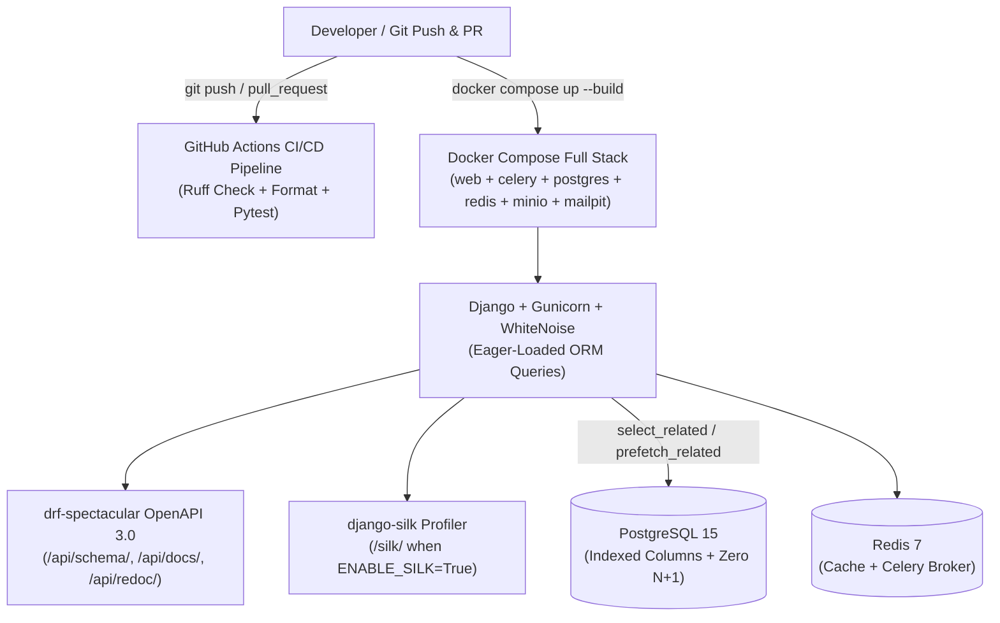
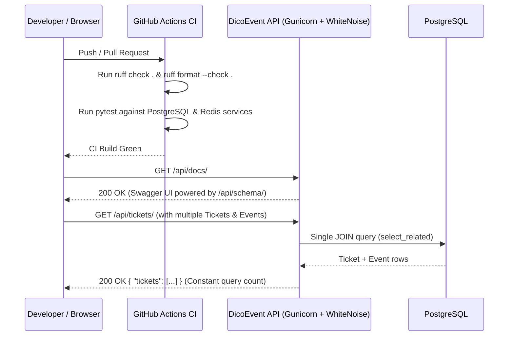

# DicoEvent DevEx, Query Optimization, OpenAPI Docs, Containerization & CI/CD Specification (V3)

**Status:** ready-for-agent

## Problem Statement

While the DicoEvent Backend (V1 + V2) satisfies functional requirements for authentication, RBAC, Event management, Redis caching, MinIO poster storage, Celery email reminders, and Loguru logging, the engineering workflow and production readiness still have five critical gaps:
1. **No Automated Linter & Formatter**: Developers lack a unified, deterministic code style and static analysis gate, increasing the risk of unused imports, formatting drift, and style inconsistencies across modules.
2. **Unoptimized ORM Queries & Lack of Query Profiling**: Resource ViewSets and permission checks traverse foreign-key relationships (`Ticket -> Event`, `Registration -> Ticket -> Event`, `Payment -> Registration`, `User -> Groups`) without eager loading (`select_related` / `prefetch_related`) or database indexes on filtered fields, exposing the platform to N+1 query regressions and lacking an interactive query profiler.
3. **No Automated OpenAPI Documentation**: Frontend engineers and API consumers have no live, self-updating OpenAPI 3.0 schema, Swagger UI, or Redoc interface to explore and test endpoints interactively.
4. **Partial Containerization**: Although infrastructure dependencies (`postgres`, `redis`, `minio`, `mailpit`) run in Docker Compose, the Django API server and Celery worker themselves lack a production-ready container image (`Dockerfile`) and static-file serving layer (`gunicorn` + `whitenoise`), preventing single-command full-stack startup.
5. **No Automated CI/CD Pipeline**: Code changes pushed to the repository or submitted via pull requests are not automatically verified against the linter, formatter, and test suite backed by real PostgreSQL and Redis instances.

## Solution

Upgrade DicoEvent Backend to a fully containerized, continuously verified, query-optimized, and self-documented platform:
- **Unified Linting & Formatting with Ruff**: Configure `Ruff` in a project configuration file (`E`, `F`, `I`, `W` rule sets, line length `120`, excluding database migrations) and format the entire repository so `ruff check .` and `ruff format --check .` pass with zero warnings.
- **Database Query Analysis, Eager Loading & Indexing**: Eliminate N+1 queries across `User`, `Event`, `Ticket`, `Registration`, and `Payment` workflows using `select_related` and `prefetch_related`, add database indexes on high-cardinality filter/order fields, enforce constant query counts in automated tests via `django_assert_num_queries`, and integrate `django-silk` (`/silk/`) for visual query profiling when `ENABLE_SILK=True` while bypassing `SilkyMiddleware` during standard test runs per ADR-0002.
- **Automated OpenAPI 3.0 Documentation with `drf-spectacular`**: Expose a live OpenAPI 3.0 schema at `/api/schema/`, an interactive Swagger UI at `/api/docs/`, and Redoc documentation at `/api/redoc/` with public read access (`AllowAny`).
- **Full-Stack Docker Containerization**: Build a unified `python:3.12-slim` container image running `gunicorn` and `whitenoise` (with automatic `collectstatic` and `migrate`), and wire both `web` (Django API) and `celery` (Celery worker) services into Docker Compose alongside `postgres`, `redis`, `minio`, and `mailpit`.
- **GitHub Actions CI/CD Pipeline**: Define an automated workflow triggered on `push` and `pull_request` that provisions PostgreSQL and Redis service containers, verifies code quality via `ruff check .` and `ruff format --check .`, and runs the complete `pytest` suite.

## User Stories

1. As a **Platform Operator**, I want a centralized `Ruff` configuration enforcing `E` (pycodestyle), `F` (Pyflakes), `I` (isort), and `W` (warnings) rules with a 120-character line length (excluding auto-generated migration files), so that code style and import ordering are consistent across the entire repository.
2. As a **Platform Operator**, I want `ruff check .` and `ruff format --check .` to pass with zero errors across all application and test modules, so that existing technical debt and formatting inconsistencies are eliminated.
3. As a **User**, I want `GET /api/events/` and `GET /api/events/<id>/` to execute with optimized database indexes on `start_time`, `status`, and `category` and eager-loaded `organizer` relations, so that browsing and filtering Events scales without redundant queries.
4. As a **User** or **Organizer**, I want `GET /api/tickets/` and `PUT`/`DELETE /api/tickets/<id>/` to eager-load the associated `Event` via `select_related`, so that listing Tickets and checking Organizer ownership (`event.organizer_id`) never triggers N+1 queries.
5. As a **Superuser** or **Admin**, I want `GET /api/registrations/` and `POST /api/registrations/` to eager-load `Ticket`, `Event`, and `User` relationships, so that listing Registrations and scheduling Celery reminder emails require a constant number of SQL queries regardless of dataset size.
6. As a **Superuser** or **Admin**, I want `GET /api/payments/` and `PUT`/`DELETE /api/payments/<id>/` to eager-load `Registration` via `select_related`, so that listing Payments and verifying ownership (`registration.user_id`) never incur N+1 queries.
7. As a **Superuser** or **Admin**, I want `GET /api/users/` and permission checks (`is_admin_user`, `is_organizer_user`) to prefetch User `groups`, so that role checks and User listings execute with minimal database round-trips.
8. As a **Platform Operator**, I want automated tests using `django_assert_num_queries` to verify that listing multiple `Events`, `Tickets`, `Registrations`, `Payments`, and `Users` executes a constant number of SQL queries (`O(1)` queries whether 1 or 10 records exist), so that N+1 query regressions are caught immediately in CI.
9. As a **Platform Operator**, I want `django-silk` available at `/silk/` when `ENABLE_SILK=True` is set in the environment, so that I can visually inspect HTTP request latencies, SQL query counts, and execution plans in a browser.
10. As a **Platform Operator**, I want `SilkyMiddleware` bypassed by default during standard `pytest` runs (unless explicitly enabled for Silk testing), so that Silk's internal telemetry inserts do not distort `django_assert_num_queries` assertions.
11. As an **API Consumer**, I want to fetch the machine-readable OpenAPI 3.0 schema at `GET /api/schema/` without authentication (`AllowAny`), so that I can import the API contract into client generators or Postman.
12. As an **API Consumer**, I want to open `GET /api/docs/` in a browser without authentication (`AllowAny`), so that I can interactively explore and test all DicoEvent endpoints via Swagger UI.
13. As an **API Consumer**, I want to open `GET /api/redoc/` in a browser without authentication (`AllowAny`), so that I can read clean, structured API reference documentation via Redoc.
14. As a **Platform Operator**, I want serializer fields and views annotated cleanly so that `drf-spectacular` generates the OpenAPI 3.0 schema without critical schema generation crashes or broken endpoints.
15. As a **Platform Operator**, I want a production-ready `Dockerfile` based on `python:3.12-slim` that installs dependencies, collects static files via `whitenoise`, runs database migrations, and starts the Django application via `gunicorn`, so that the API and static UI assets (`/api/docs/`, `/api/redoc/`, `/silk/`, `/admin/`) are self-contained.
16. As a **Platform Operator**, I want Docker Compose to define both the `web` (Django API) service and the `celery` (Celery worker) service alongside `postgres`, `redis`, `minio`, and `mailpit`, so that running `docker compose up --build` launches the entire DicoEvent platform in one command.
17. As a **Platform Operator**, I want a `.dockerignore` file excluding local virtual environments, `.git`, `.pytest_cache`, `.scratch`, and log files, so that Docker image builds remain fast, lean, and clean.
18. As a **Platform Operator**, I want a GitHub Actions CI workflow triggered on every `push` and `pull_request` that spins up PostgreSQL and Redis service containers, runs `ruff check .` and `ruff format --check .`, and executes `pytest` against the live service containers, so that broken code or style violations cannot be merged silently.

## Implementation Decisions

- **Linter & Formatter Configuration (`Ruff`)**:
  - Add `ruff` to the development dependencies in `Pipfile` and `requirements.txt`.
  - Configure `ruff` in `pyproject.toml` with `target-version = "py312"`, `line-length = 120`, and `extend-exclude = ["migrations", ".scratch", ".pytest_cache"]`.
  - Enable lint rule selectors `["E", "F", "I", "W"]` under `[tool.ruff.lint]`.
  - Format and clean all existing Python files across the repository so both `ruff check .` and `ruff format --check .` exit with code `0`.
- **Database Query Analysis, ORM Optimization & `django-silk` (ADR-0002)**:
  - Update ViewSet querysets and permission/serializer lookups:
    - `User`: prefetch `groups` on `UserViewSet` queryset to avoid repeated group queries.
    - `Event`: `select_related('organizer')` on `EventViewSet` queryset and add model indexes (`models.Index`) on `start_time`, `status`, and `category`.
    - `Ticket`: `select_related('event', 'event__organizer')` on `TicketViewSet` queryset.
    - `Registration`: `select_related('ticket', 'ticket__event', 'user')` on `RegistrationViewSet` queryset and `Ticket.objects.select_related('event')` when resolving `ticket` during Registration creation so `schedule_event_reminder` does not trigger an extra query for `ticket.event`.
    - `Payment`: `select_related('registration', 'registration__user')` on `PaymentViewSet` queryset.
  - Integrate `django-silk`:
    - Add `django-silk` to dependencies.
    - Conditionally enable `silk` in `INSTALLED_APPS`, `SilkyMiddleware` in `MIDDLEWARE`, and `path('silk/', include('silk.urls', namespace='silk'))` in root URLs when `ENABLE_SILK` is enabled (defaulting to `False` when `RUNNING_TESTS` is `True`, and `True` in local/Docker development unless overridden), adhering strictly to **ADR-0002**.
- **Automated OpenAPI 3.0 Documentation (`drf-spectacular`)**:
  - Add `drf-spectacular` to dependencies and register `'drf_spectacular'` in `INSTALLED_APPS`.
  - Set `'DEFAULT_SCHEMA_CLASS': 'drf_spectacular.openapi.AutoSchema'` in `REST_FRAMEWORK` settings and configure `SPECTACULAR_SETTINGS` with title `"DicoEvent API"`, description, version `"2.0.0"`, and `SERVE_INCLUDE_SCHEMA = False`.
  - Expose optional-trailing-slash routes in URL configuration with `AllowAny` permissions:
    - `/api/schema/` (`SpectacularAPIView`)
    - `/api/docs/` (`SpectacularSwaggerView`)
    - `/api/redoc/` (`SpectacularRedocView`)
- **Full-Stack Containerization (`Dockerfile`, `.dockerignore`, `docker-compose.yml`)**:
  - Add `gunicorn` and `whitenoise` to dependencies; configure `WhiteNoiseMiddleware` right after `SecurityMiddleware` and set `STATIC_ROOT = BASE_DIR / 'staticfiles'`.
  - Create a `Dockerfile` using `python:3.12-slim` that installs dependencies from `requirements.txt`, copies project files, runs `python manage.py collectstatic --noinput`, and uses an entrypoint script (`docker-entrypoint.sh` or inline command) that runs `python manage.py migrate --noinput` before starting `gunicorn dicoevent.wsgi:application --bind 0.0.0.0:8000`.
  - Update `docker-compose.yml` to include:
    - Healthchecks on `postgres` and `redis`.
    - Service `web` building from `.`, exposing port `8000:8000`, configured with environment variables pointing to `postgres`, `redis`, `minio:9000`, and `mailpit`, with `ENABLE_SILK=True`.
    - Service `celery` building from `.`, running `celery -A dicoevent worker -l info`, sharing the same service environment variables and depending on `redis`, `postgres`, and `mailpit`.
- **CI/CD Pipeline (`.github/workflows/ci.yml`)**:
  - Create a GitHub Actions workflow triggered on `push` (branches `main`, `master`, `feat/**`) and `pull_request`.
  - Configure service containers for `postgres:15-alpine` (port `5432`, health-checked) and `redis:7-alpine` (port `6379`, health-checked).
  - Steps: checkout code, set up Python 3.12 with pip caching, install dependencies from `requirements.txt`, run `ruff check .`, run `ruff format --check .`, run `python manage.py migrate`, and run `pytest` with `USE_SQLITE_TEST=False` against the PostgreSQL and Redis service containers.

## Testing Decisions

- **Philosophy**: Tests verify observable external behaviour—HTTP status codes, OpenAPI schema content, exact SQL query counts via `django_assert_num_queries`, CLI exit codes for `ruff`, and structural invariants of container/CI configurations—while preserving 100% pass rate on all existing V1 and V2 tests and ADR-0001 compatibility rules.
- **Primary Seams**:
  1. **API & Query Count Seam (`APIClient` + `django_assert_num_queries`)**:
     - Verify `GET /api/schema/`, `GET /api/docs/`, and `GET /api/redoc/` return `200 OK` without authentication and include all core DicoEvent resource paths (`/api/events/`, `/api/tickets/`, `/api/registrations/`, `/api/payments/`, `/api/users/`, `/api/groups/`).
     - Verify `GET /api/events/`, `GET /api/tickets/`, `GET /api/registrations/`, `GET /api/payments/`, and `GET /api/users/` execute in a bounded, constant number of queries (`O(1)`) when scaling from 2 records to 10 records, proving zero N+1 queries.
     - Verify `django-silk` URLs (`/silk/`) are reachable when enabled and that `SilkyMiddleware` is cleanly bypassed during standard test runs.
  2. **Static Analysis & DevOps Contract Seam (`subprocess` & YAML/Dockerfile inspection in `pytest`)**:
     - Verify `ruff check .` and `ruff format --check .` exit with status code `0`.
     - Verify `Dockerfile`, `.dockerignore`, `docker-compose.yml` (`web` and `celery` services), and `.github/workflows/ci.yml` exist, parse as valid YAML, and define the required services and steps.
- **Prior Art**: Existing test modules in `tests/` (`test_events.py`, `test_tickets.py`, `test_registrations.py`, `test_payments.py`, `test_settings.py`) use `pytest-django` fixtures and `APIClient`.

## Out of Scope

- Kubernetes (`k8s`) Helm charts or cloud-provider-specific Terraform deployments (AWS ECS, GCP Cloud Run).
- Continuous Deployment (CD) to a live staging/production remote server requiring cloud credentials.
- APM agents requiring paid external SaaS keys (Datadog, New Relic, Sentry SaaS).

## Further Notes

- All domain terminology in code, documentation, and tests must strictly adhere to `GLOSSARY.md`.
- All API routes and behaviors must preserve **ADR-0001** (`docs/adr/0001-postman-test-suite-compatibility.md`) and **ADR-0002** (`docs/adr/0002-devex-and-query-profiling-architecture.md`).
