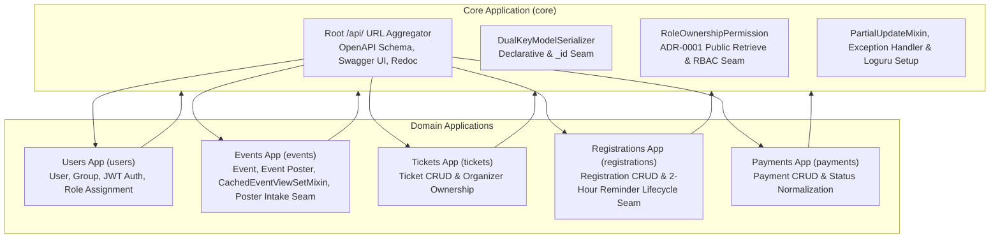

# DicoEvent Multi-App Domain Architecture & Deep Module Refactoring

**Status:** ready-for-agent

## Problem Statement

The DicoEvent platform currently houses all domain concepts (**User**, **Group**, **Event**, **Event Poster**, **Ticket**, **Registration**, **Payment**) inside a single monolithic Django application partitioned by horizontal technical roles. Understanding or modifying any single domain concept requires navigating across six to eight disparate modules, destroying **locality**. Furthermore, several modules are **shallow** pass-throughs that leak low-level mechanics across their **seams** into HTTP views:
- **Event** views manually orchestrate cache lookups, query-string normalization, cache-key invalidation, and `X-Data-Source` header tagging across five methods.
- **Event Poster** upload views manually enforce **Organizer** ownership rules, invoke object storage client uploads, create database records, and construct response dictionaries inline.
- **Registration** creation views inline asynchronous reminder scheduling with ad-hoc error handling, meaning **Registrations** created outside the HTTP view silently skip the 2-hour pre-**Event** reminder invariant.
- Serializers and permission classes duplicate dual-key foreign key resolution (`<field>` and `<field>_id`) and Role-Based Access Control (RBAC) / ADR-0001 public detail retrieve checks across every resource.

## Solution

Replace the monolithic application with a pure Multi-App Django architecture composed of five cohesive domain applications (`users`, `events`, `tickets`, `registrations`, `payments`) and one shared infrastructure application (`core`), all organized under a dedicated application namespace while completely removing the legacy monolithic package. Preserve 100% of external REST contracts, PostgreSQL table names, OpenAPI schema definitions, and Postman test suite compatibility rules (ADR-0001 & ADR-0002), while deepening the internal modules of each domain application behind narrow, declarative **seams** (ADR-0003).

## User Stories

1. As a platform maintainer, I want all **User**, **Group**, authentication, and role-assignment logic isolated inside a dedicated `users` Django application, so that identity and RBAC concerns have high **locality**.
2. As a platform maintainer, I want the custom **User** model registered under the `users` application label while preserving the `users` database table name and seeded `Aras` **Superuser**, so that authentication and database schemas remain intact.
3. As a platform maintainer, I want all **Event**, **Event Poster**, Redis caching, and MinIO object storage modules co-located inside a dedicated `events` Django application, so that changes to **Event** discovery or media handling occur within a single domain module.
4. As a platform maintainer, I want all **Ticket** management logic isolated inside a dedicated `tickets` Django application, so that admission tier pricing, sales windows, and **Organizer** ownership rules are self-contained.
5. As a platform maintainer, I want all **Registration** management and asynchronous 2-hour pre-**Event** reminder scheduling co-located inside a dedicated `registrations` Django application, so that attendee booking and reminder notifications share a single module boundary.
6. As a platform maintainer, I want all **Payment** settlement logic and status normalization isolated inside a dedicated `payments` Django application, so that financial settlement rules are decoupled from booking and catalog modules.
7. As a platform maintainer, I want shared cross-cutting primitives (`DualKeyModelSerializer`, `RoleOwnershipPermission`, `PartialUpdateMixin`, custom exception handling, Loguru configuration, and `/api/` URL aggregation) housed in a dedicated `core` Django application, so that domain applications gain **leverage** without duplicating boilerplate.
8. As a platform maintainer, I want the legacy monolithic application directory completely removed and all test suites updated to reference the new domain applications, so that no dead shims or ambiguous import paths remain in the repository.
9. As a developer working on **Events**, I want `EventViewSet` to delegate cache lookups, cache writes, mutation invalidation, and `X-Data-Source` (`cache` vs `database`) response header injection to a deep `CachedEventViewSetMixin` seam, so that the viewset only declares its queryset, serializer, pagination, and filters.
10. As a developer working on **Event Posters**, I want `EventPosterUploadView` to delegate **Organizer** ownership checks, MinIO object upload, and **Event Poster** persistence to a deep intake module (`attach_event_poster`), so that the HTTP view only adapts requests and responses.
11. As a developer working on **Registrations**, I want **Registration** creation to automatically trigger resilient 2-hour pre-**Event** reminder scheduling inside the serializer/creation lifecycle, so that any caller creating a **Registration** honours the reminder invariant without inline task orchestration in the HTTP view.
12. As a developer defining domain serializers, I want a declarative `DualKeyModelSerializer` base module that automatically resolves `<field>` or `<field>_id` on input (with caller-supplied eager-loading querysets) and outputs both `<field>` and `<field>_id` as strings, so that **Event**, **Ticket**, **Registration**, and **Payment** serializers do not repeat procedural foreign-key plumbing.
13. As a developer defining resource permissions, I want a declarative `RoleOwnershipPermission` base module that enforces ADR-0001 unauthenticated detail `retrieve`, **Superuser** and **Admin** platform-wide access, **Organizer** ownership on **Events** and **Tickets**, and **User** ownership on **Registrations**, **Payments**, and **User** profiles, so that authorization rules are defined in one place.
14. As an **Organizer**, I want to create, update, and delete my own **Events** and **Tickets**, and upload **Event Posters** (up to 500 KB) to my own **Events**, while being forbidden from modifying another **Organizer**'s resources.
15. As a **User**, I want to register an account, log in to receive a 3-hour JWT access token, browse **Events** and **Event Posters**, book **Tickets** via **Registrations**, receive an automated email reminder 2 hours before my **Event** starts, and submit **Payments** (with case-insensitive `"completed"` normalized to `"Completed"` on update).
16. As an **Admin**, I want full read and write access across all **Users**, **Events**, **Event Posters**, **Tickets**, **Registrations**, and **Payments**, while remaining restricted from managing **Groups** or assigning roles.
17. As a **Superuser**, I want unrestricted access across the entire platform, including creating/updating/deleting **Groups** and assigning **Groups** to **Users**.
18. As an API consumer or automated Postman runner, I want all `/api/*` endpoints (with or without trailing slashes), unauthenticated detail `GET` requests, cascading deletion from **Ticket** to **Registration** and **Payment**, OpenAPI documentation (`/api/schema/`, `/api/docs/`, `/api/redoc/`), and constant `O(1)` SQL query counts to work identically after the Multi-App migration.

## Implementation Decisions

1. **Application Layout & Registration**:
   - Six Django applications are registered in `INSTALLED_APPS`: `core`, `users`, `events`, `tickets`, `registrations`, and `payments`, each residing in its own package under the `apps` namespace and declaring its short application `label` (`core`, `users`, `events`, `tickets`, `registrations`, `payments`).
   - `AUTH_USER_MODEL` is set to `"users.User"`.
   - The legacy monolithic application directory is completely deleted.

2. **Database Schema & Migration Invariants**:
   - Every domain model explicitly preserves its existing `db_table` name (`users`, `events`, `event_posters`, `tickets`, `registrations`, `payments`) and UUID primary key structure.
   - Each domain application owns its clean initial migration (`0001_initial`) reflecting its models, database indexes (`start_time`, `status`, `category` on **Event**), and `on_delete=models.CASCADE` relationships (ADR-0001).
   - The `users` application includes the data migration seeding the default **Superuser** (`Aras`) right after its initial schema migration.

3. **Shared Core Module (`core`)**:
   - **URL Aggregation**: The root URL configuration mounts `/api/` from the `core` URL module, which serves the public OpenAPI endpoints (`/api/schema/`, `/api/docs/`, `/api/redoc/`) and includes the URL patterns of `users`, `events`, `tickets`, `registrations`, and `payments`. All routes continue to accept optional trailing slashes (`/?$`).
   - **`DualKeyModelSerializer`**: A model-agnostic base serializer module (satisfying Coding Standard #2) that reads a declarative configuration of dual-key foreign key relations (each specifying its field name, model/queryset with eager-loading hints, and error label). On validation, it resolves either `<field>` or `<field>_id` into the target model instance using `_resolve_foreign_key`. On representation, it ensures UUID primary keys and both `<field>` and `<field>_id` keys are serialized as strings.
   - **`RoleOwnershipPermission`**: A deep permission module encapsulating:
     - Unauthenticated `GET` access on `retrieve` actions (ADR-0001) and configured public endpoints.
     - Request-scoped caching of lowercase **Group** names on the **User** instance to prevent repeated role queries.
     - Full bypass for **Superuser** and **Admin** actors on domain resources.
     - Declarative ownership verification for **Organizer**-owned resources (**Event**, **Ticket**) and **User**-owned resources (**Registration**, **Payment**, **User** self-profile).
   - **Shared Infrastructure**: Houses `PartialUpdateMixin` (defaulting `PUT` updates to partial updates per ADR-0001), `custom_exception_handler`, and `setup_logging`.

4. **Deepened Events Module (`events`)**:
   - **`CachedEventViewSetMixin`**: Absorbs all cache coordination previously inlined in `EventViewSet`. It intercepts `list` and `retrieve` to serve cached payloads (setting `X-Data-Source: cache`) or populate the cache on a miss (setting `X-Data-Source: database`), and intercepts `perform_create`, `perform_update`, and `perform_destroy` to invalidate the **Event** cache registry. Low-level cache helper functions (`get_cached_event_list`, `set_cached_event_list`, `get_cached_event_detail`, `set_cached_event_detail`, `invalidate_event_caches`) remain exported in the `events` caching module.
   - **Deep Event Poster Intake (`attach_event_poster`)**: Co-located in the `events` storage module alongside `upload_poster_to_minio`, `get_minio_client`, and `parse_minio_endpoint`. `attach_event_poster` verifies that a non-**Admin** **Organizer** owns the target **Event** (raising a permission error mapped to HTTP 403 otherwise), uploads the validated image (up to 500 KB, verified with Pillow) via `upload_poster_to_minio`, and creates and returns the `EventPoster` record. `EventPosterUploadView` and `EventPostersListView` serialize responses through `EventPosterSerializer`.

5. **Deepened Registrations Module (`registrations`)**:
   - **Registration Creation & Reminder Lifecycle**: `RegistrationSerializer.create` persists the `Registration` instance and immediately invokes `schedule_event_reminder(registration)` inside a resilient error boundary that logs scheduling failures without aborting the HTTP 201 response.
   - `send_event_reminder_email` and `schedule_event_reminder` live in the `registrations` tasks module and are auto-discovered by Celery across all installed apps.

6. **Users, Tickets, and Payments Modules (`users`, `tickets`, `payments`)**:
   - `users` owns the custom `User` model, `UserViewSet` (with `prefetch_related("groups")`), `GroupViewSet` (restricted to **Superuser**), `AssignRoleView` (restricted to **Superuser**), and JWT login/refresh views (`3 hours` access token lifetime).
   - `tickets` owns the `Ticket` model, `TicketSerializer` (inheriting `DualKeyModelSerializer` for `event` / `event_id` and enforcing non-negative price, positive quota, and `sales_start < sales_end`), and `TicketViewSet` (with `select_related("event", "event__organizer")`).
   - `payments` owns the `Payment` model, `PaymentSerializer` (inheriting `DualKeyModelSerializer` for `registration` / `registration_id` and normalizing case-insensitive `"completed"` to `"Completed"` per ADR-0001), and `PaymentViewSet` (with `select_related("registration", "registration__user")`).

## Testing Decisions

1. **Principles of Good Tests**:
   - Tests assert on observable external behavior through the highest seam possible (HTTP status codes, JSON payloads, response headers, database state, and observable `O(1)` SQL query counts via `django_assert_num_queries`), never on private ORM compiler structures (Coding Standard #3).
2. **Agreed Testing Seams**:
   - **HTTP REST Seam (`APIClient` at `/api/*`)**: The primary test surface for all CRUD flows, RBAC matrix enforcement, ADR-0001 compatibility behaviors, OpenAPI schema validation, Redis cache hit/miss/invalidation lifecycle (`X-Data-Source` headers), and `O(1)` query count assertions across `users`, `events`, `tickets`, `registrations`, and `payments`.
   - **Object Storage Seam (`apps.events.storage`)**: Used to test MinIO endpoint parsing, bucket auto-creation, and `upload_poster_to_minio` invocation/failure handling without requiring a live MinIO server during unit tests.
   - **Task Dispatch Seam (`apps.registrations.tasks`)**: Used to verify 2-hour pre-**Event** ETA calculation (`start_time - 2 hours`), immediate fallback execution when within the 2-hour window, and SMTP email delivery via `send_event_reminder_email` and `schedule_event_reminder`.
3. **Test Suite Migration & Prior Art**:
   - All existing test modules in `tests/` are updated to import models, views, storage helpers, and Celery tasks from their canonical new modules under `apps.<domain>.*` while keeping all 180 behavioral assertions and `ruff` lint/format checks green.

## Out of Scope

- Changing any public URL paths, HTTP request/response JSON shapes, or authentication token formats.
- Modifying the PostgreSQL database table names or column schemas depicted in the project ERD.
- Splitting the single repository into separate microservice repositories or separate databases.

## Further Notes

- Follow Coding Standard #1 (exact domain invariants in OpenAPI annotations and docstrings: `500 KB` for **Event Poster**, `3 hours` for JWT access token, `2 hours` for pre-**Event** reminder), Coding Standard #2 (model-agnostic shared helpers in `core`), and Coding Standard #3 (behavioral query assertions).
